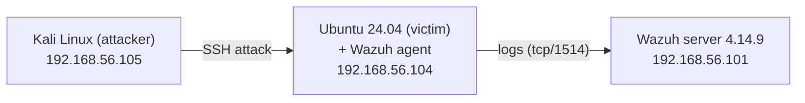
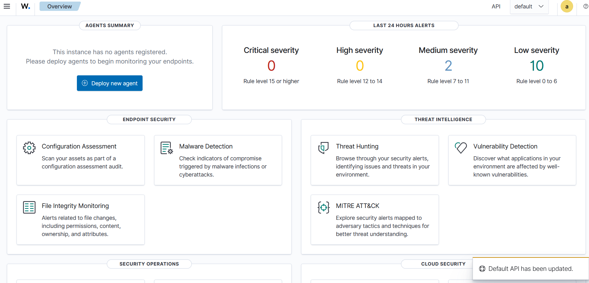
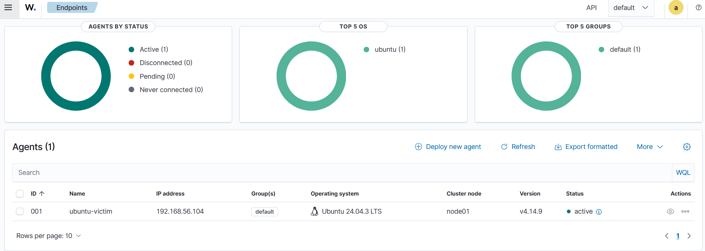

# My Wazuh SOC Home Lab

I built this lab to learn how a SOC actually works: deploy a SIEM, connect a
machine to it, attack that machine, and then try to catch the attack from the
analyst side. Everything runs in VirtualBox on my own laptop, in an isolated
network, so the only thing I attack is a VM I own.

I'm a cybersecurity student (3rd year, Wrocław University of Science and
Technology) and this is part of my portfolio. I'm adding more scenarios as I go.

## The setup

Three VMs on a VirtualBox host-only network `192.168.56.0/24`:

| Host | Role | OS | IP |
|---|---|---|---|
| wazuh-server | SIEM (manager + indexer + dashboard) | Amazon Linux 2023 | .101 |
| ubuntu-victim | monitored endpoint | Ubuntu 24.04.3 LTS | .104 |
| kali | attacker | Kali Linux | .105 |

Wazuh server came as the official OVA (v4.14.9). Before importing it I checked
the SHA512 against the one on the Wazuh site, just to get into the habit of
verifying downloads.

## What I've done so far

- Deployed the Wazuh server and got the dashboard working.
- Changed the default passwords straight away (the OVA ships with
  `wazuh-user/wazuh` and `admin/admin`, which is exactly the kind of thing an
  attacker tries first).
- Installed Ubuntu Server as the victim and enrolled the Wazuh agent on it.
  Took me a couple of tries — the first install got stuck downloading updates
  and never created my user, so I reinstalled and skipped that step.
- Ran a brute-force SSH attack from Kali with Hydra and caught it in Wazuh.
- Wrote up the brute-force as a proper incident report.
- Set up Active Response so Wazuh auto-blocks the attacker's IP with iptables,
  and tested it (the block appears within seconds and expires after 180s).

Wazuh dashboard once the agent was reporting:

## Incidents

| ID | What happened | MITRE | Result |
|---|---|---|---|
| [IR-2026-001](./incidents/2026-10-26_ssh-brute-force.md) | SSH brute force from Kali | T1110 | caught, attack failed |
| [IR-2026-002](./incidents/2026-10-26_active-response.md) | Auto-block the brute-force source (Active Response) | T1110 | attacker auto-blocked via iptables |
| [IR-2026-003](./incidents/2026-10-26_rogue-account.md) | Rogue root account created on the victim | T1136 / T1098 | detected and removed |

(template I use for these: [`incidents/TEMPLATE.md`](./incidents/TEMPLATE.md))

## Notes to self / next steps

- Try a privilege-escalation scenario on the Ubuntu box.
- Go through the CIS benchmark failures the SCA module found and fix a few.

## Tools used
Wazuh, VirtualBox, Kali, Hydra, Linux, SSH, MITRE ATT&CK.
