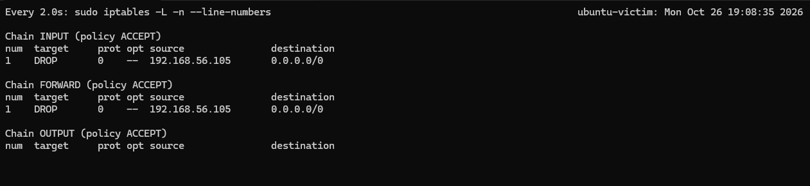
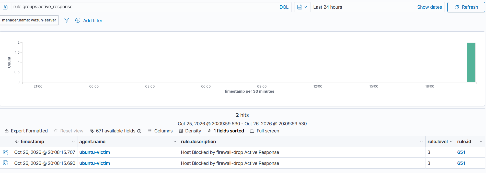

# IR-2026-002 — Active Response auto-blocking the brute-force source

**Analyst:** Ivan Bildzia
**Date:** 2026-10-26 (times in UTC)
**Detected by:** Wazuh rule 5763 → Active Response (rule 651)
**MITRE:** T1110 Brute Force (Credential Access)
**Status:** closed — attacker auto-blocked

## Goal
After IR-2026-001 I recommended auto-blocking brute-force sources. Here I
actually implemented it with Wazuh Active Response and tested that it works.

## What I configured
On the Wazuh server I added an Active Response block to
`/var/ossec/etc/ossec.conf` (backed up the file first):

```xml
<active-response>
  <command>firewall-drop</command>
  <location>local</location>
  <rules_id>5763</rules_id>
  <timeout>180</timeout>
</active-response>
```

Meaning: when rule 5763 (SSH brute force) fires, the agent on the affected host
runs `firewall-drop`, which adds an iptables DROP rule for the attacker's IP for
180 seconds, then removes it automatically.

## The test
I re-ran the same Hydra brute force from Kali (192.168.56.105) against
ubuntu-victim. Within a couple of seconds of rule 5763 firing, the attacker IP
was blocked.

On ubuntu-victim, iptables showed the DROP rule appear automatically:
```
Chain INPUT (policy ACCEPT)
num  target  prot opt source           destination
1    DROP    0   --  192.168.56.105     0.0.0.0/0

Chain FORWARD (policy ACCEPT)
1    DROP    0   --  192.168.56.105     0.0.0.0/0
```

From Kali's side, Hydra's connections broke (garbled output instead of clean
"Failed password" lines) because the host had stopped answering.

In the dashboard the response was logged as rule 651 — "Host Blocked by
firewall-drop Active Response" — on agent ubuntu-victim.




## Result
- Attacker blocked ~2s after detection, no human action needed.
- Block auto-expired after 180s (timeout), so a false positive wouldn't lock
  someone out permanently.
- This turns the IR-2026-001 recommendation into a working control.

## Notes / what I learned
- `location: local` runs the response on the agent that saw the attack, which is
  what you want — the block happens right at the target.
- The timeout matters: a permanent block on a brute-force rule is risky because a
  spoofed source IP could be used to lock out legitimate traffic (a
  self-inflicted denial of service). 180s is a safer default.
- Active Response is basically the "SOAR" idea on a small scale: detection
  automatically triggers a response.

---
*Lab only — all of this was done against my own VMs.*
