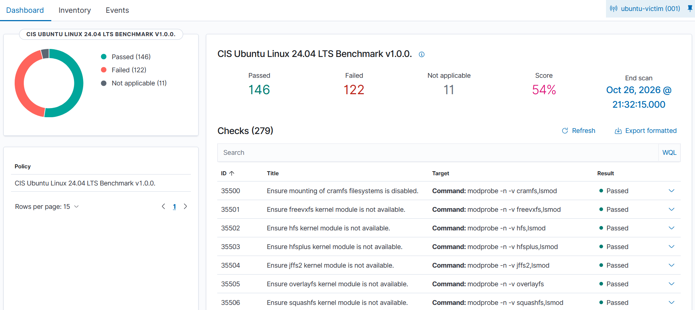

# Hardening — CIS Benchmark on ubuntu-victim

**Analyst:** Ivan Bildzia
**Date:** 2026-10-26
**Reference:** Wazuh SCA — CIS Ubuntu Linux 24.04 LTS Benchmark v1.0.0
**Asset:** ubuntu-victim

## Goal
Raise the host's CIS compliance score from the baseline and, in particular,
close the audit gap I found back in IR-003 (no auditing of `/etc/sudoers.d`).

## Baseline
First SCA scan: **Passed 119 / Failed 118 / N/A 42 — Score 50%**.

## What I changed (safe controls only)
I deliberately avoided controls that could break access or need a rebuild
(firewall/nftables rules, separate `/tmp` partition, bootloader password), and
fixed the ones that are safe in this environment:

- **Auditing (the IR-003 fix):** installed `auditd`, deployed a full CIS audit
  ruleset (sudoers scope, identity files, permission/ownership changes, logins,
  session, deletes, kernel modules, privileged commands), made it immutable
  (`-e 2`), and enabled audit in the bootloader (`audit=1 audit_backlog_limit=8192`).
- **Password policy:** installed `libpam-pwquality`, set `PASS_MIN_DAYS`, set
  default inactive-password lock (`useradd -D -f 30`).
- **Session timeout:** `TMOUT=900` in `/etc/profile.d`.
- **Core dumps restricted:** `* hard core 0`, `fs.suid_dumpable=0`.
- **Automatic error reporting (apport) disabled** and a login warning banner set.

## Result
After re-scanning:

| Scan | Passed | Failed | N/A | Score |
|---|---|---|---|---|
| Baseline | 119 | 118 | 42 | 50% |
| After package fixes | 134 | 134 | 11 | 50% |
| After audit rules + grub | **146** | 122 | 11 | **54%** |

Net: **+27 checks passing**, score 50% → 54%.

## An important nuance
After the first round the score stayed at 50% even though I fixed ~15 checks.
Reason: installing `auditd` made ~31 previously "Not applicable" audit checks
*applicable*, and many of those then failed until I deployed the actual audit
rules. So the raw percentage hid real progress. Only after loading the full
ruleset did the score move. Lesson: when hardening, the N/A count matters — a
"good" score can just mean a control isn't installed yet.

## Why I stopped at 54%
The remaining failures are mostly structural or risky to change in this lab:
- separate partitions for `/tmp`, `/var`, `/home` (needs a reinstall/repartition),
- bootloader password,
- firewall default-deny with nftables (could cut off my own SSH),
- AIDE with scheduled integrity checks.

In a real environment these go through change control and a maintenance window,
not a one-shot script. Fixing them blindly is how you lock yourself out of a
server.

---
*Lab only — all changes made to my own VM.*
