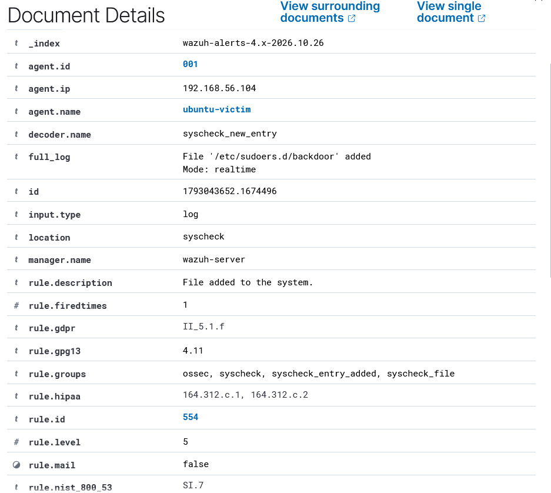

# IR-2026-004 — Closing the sudoers blind spot with File Integrity Monitoring

**Analyst:** Ivan Bildzia
**Date:** 2026-10-26 (times in UTC)
**Detected by:** Wazuh FIM (syscheck) — rule 554 "File added to the system"
**MITRE:** T1098 Account Manipulation · T1548 Abuse Elevation Control
**Status:** fixed — blind spot now covered

## Why
In IR-2026-003 I noticed a gap: writing `/etc/sudoers.d/backdoor` produced no
dedicated alert, only a generic "sudo to root". So an attacker editing sudoers
directly could slip by. Here I close that gap with File Integrity Monitoring
and prove it works.

## What I changed
On the agent (ubuntu-victim) I added real-time FIM to `/var/ossec/etc/ossec.conf`
(backed up first), inside the `<syscheck>` block:
```xml
<directories realtime="yes" report_changes="yes" check_all="yes">/etc/sudoers.d</directories>
<directories realtime="yes" report_changes="yes" check_all="yes">/etc/passwd,/etc/shadow</directories>
```
- `realtime` — alert the moment the file changes, not on the next scan.
- `report_changes` — record what actually changed (diff).

Then restarted the agent.

## Test
I recreated the same malicious file:
```bash
echo 'backdoor ALL=(ALL) NOPASSWD:ALL' | sudo tee /etc/sudoers.d/backdoor
```

This time Wazuh fired an FIM alert within seconds:
```
** Alert ...: - ossec,syscheck,syscheck_entry_added,syscheck_file,
   pci_dss_11.5,gdpr_II_5.1.f,hipaa_164.312.c.1,nist_800_53_SI.7,tsc_CC7.2,...
2026 Oct 26 19:40:52 (ubuntu-victim) any->syscheck
Rule: 554 (level 5) -> 'File added to the system.'
File '/etc/sudoers.d/backdoor' added
```



## Before vs after
| | IR-2026-003 (before) | IR-2026-004 (after) |
|---|---|---|
| Write to `/etc/sudoers.d/` | no dedicated alert | rule 554, real-time FIM alert |
| Visibility of the change | only "sudo to root" (level 3) | exact file + path, compliance-tagged |

## Result
The blind spot is closed. Any create/modify/delete under `/etc/sudoers.d`,
`/etc/passwd` or `/etc/shadow` now raises its own alert immediately. This is the
kind of monitoring the CIS benchmark (SCA check 35731) was asking for.

## Cleanup
```bash
sudo rm -f /etc/sudoers.d/backdoor
```

## Note
Rule 554 is only level 5 by default. In a real deployment I'd write a custom
rule to raise the severity when the changed file is under `/etc/sudoers.d` or is
`/etc/passwd` / `/etc/shadow`, since those changes are high-value.

---
*Lab only — all of this was done against my own VM.*
