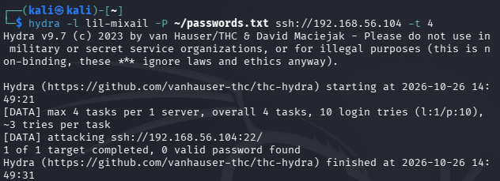
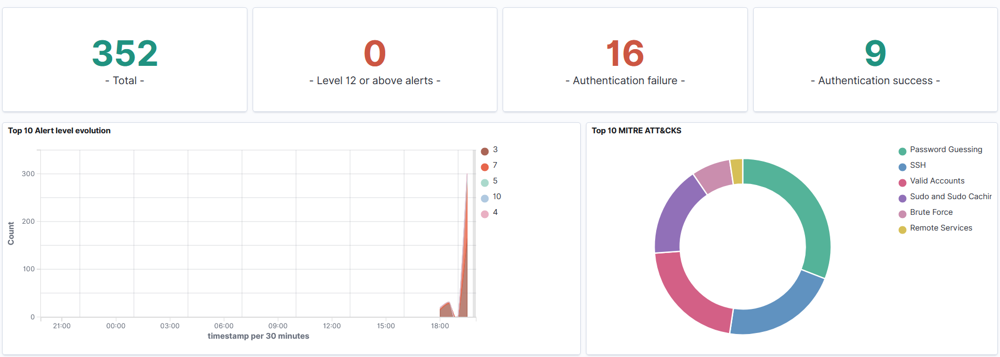
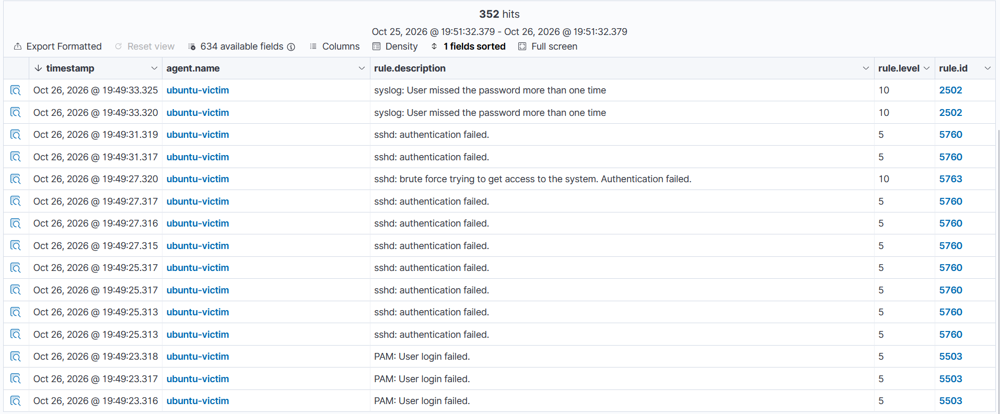
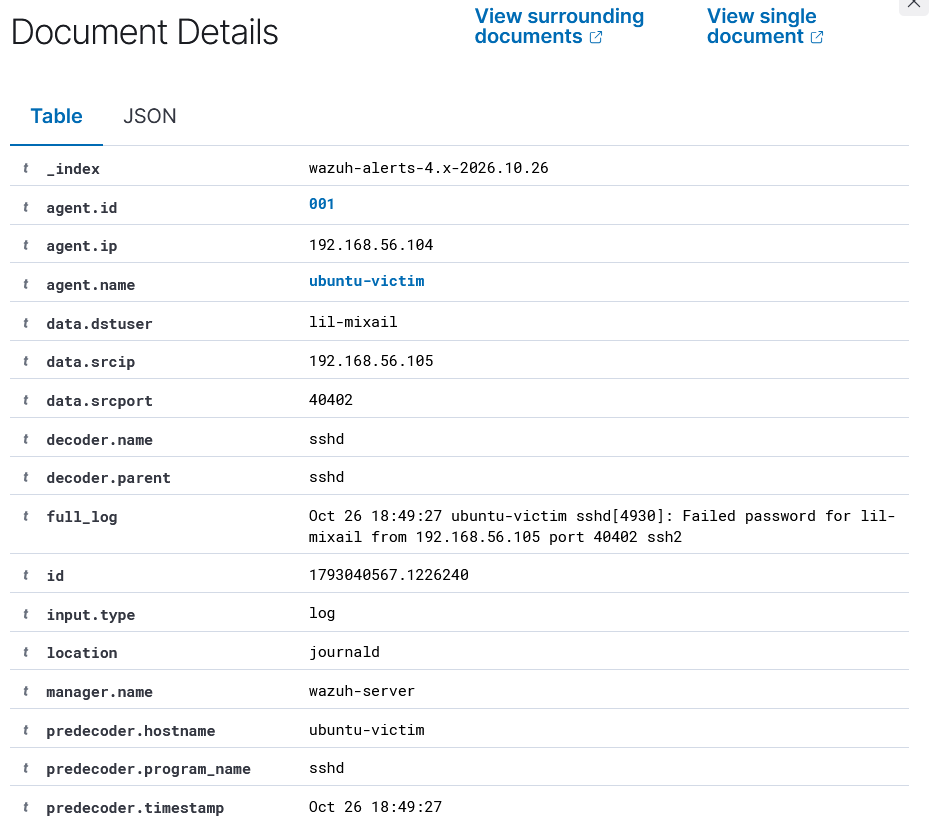

# IR-2026-001 — SSH brute force against ubuntu-victim

**Analyst:** Ivan Bildzia
**Date:** 2026-10-26 (times below in UTC)
**Detected by:** Wazuh rule 5763 — "sshd: brute force trying to get access"
**Severity:** level 10/15
**MITRE:** T1110 Brute Force (Credential Access)
**Status:** closed, attack failed

## What happened
I ran a password-guessing attack over SSH from my Kali VM (192.168.56.105)
against the user `lil-mixail` on ubuntu-victim (192.168.56.104). I used Hydra
with a short list of common passwords. None of them were correct, so the attack
failed, but the point was to see how it shows up in Wazuh. It showed up clearly.




## The alert
After about 8 failed logins in a few seconds, Wazuh escalated from individual
"authentication failed" events (rule 5760, level 5) to the brute-force rule
5763 at level 10. That jump is the interesting part: one failed login is
nothing, but Wazuh counts them per source IP and once it passes the threshold
(frequency 8 here) it decides it's an attack. So the SIEM is doing the
correlation I'd otherwise have to do by eye.

Raw log behind the alert:
```
Oct 26 18:49:27 ubuntu-victim sshd[4930]: Failed password for
lil-mixail from 192.168.56.105 port 40402 ssh2
```

The event list showing the rule chain (many 5760s escalating to 5763):



The expanded 5763 alert with the attacker IP and raw log:



Key fields from the alert:
- `data.srcip` = 192.168.56.105 (the attacker — this is the field I'd pivot on)
- `data.dstuser` = lil-mixail (the account being hit)
- `rule.id` = 5763, `rule.level` = 10, `rule.frequency` = 8
- log came in through journald / sshd decoder

## Timeline (UTC)
- 18:49:19 — first failed password from .105
- 18:49:19–27 — 8+ failures, source ports 40382–40402
- 18:49:27 — rule 5763 fires (brute force detected)
- after that — 0 successful logins, attack ends

## One thing I had to be careful about
In the same time window Wazuh also logged 9 *successful* authentications —
those were my own SSH sessions and sudo commands while setting things up. If I
hadn't checked the source IP I could have confused my own activity with the
attack. Good reminder that not every auth event is hostile.

## Impact
None. Every attempt failed, no access gained.

## Compliance
Wazuh tagged the alert with PCI DSS (11.4, 10.2.4, 10.2.5) and NIST 800-53
(SI.4, AU.14, AC.7), plus HIPAA/GDPR/TSC controls. Useful to know these alerts
already map to audit requirements.

## What I'd recommend fixing
- Turn off SSH password auth, use SSH keys instead.
- Add fail2ban or Wazuh Active Response to auto-block the IP after N failures.
- Don't expose SSH openly — firewall allow-list or VPN.
- MFA for remote access.

I'm planning to actually implement the Active Response part next and update this.

---
*Lab only — all of this was done against my own VM.*
