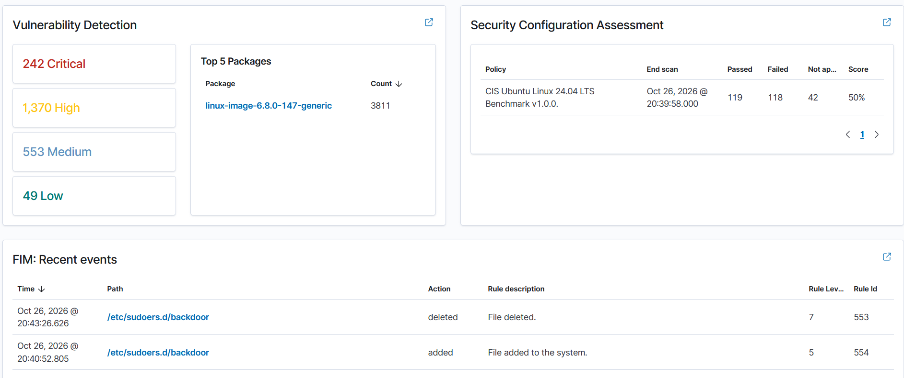

# Vulnerability Assessment — ubuntu-victim

**Analyst:** Ivan Bildzia
**Date:** 2026-10-26
**Tool:** Wazuh Vulnerability Detection (package inventory vs CVE feeds)
**Asset:** ubuntu-victim (Ubuntu 24.04.3 LTS, kernel 6.8.0-147-generic)

## Summary
Wazuh scanned the installed packages on ubuntu-victim and matched them against
known CVEs. The box was installed without applying updates (on purpose, so there
would be something to find), and the scan returned a large backlog:

| Severity | Count |
|---|---|
| Critical | 242 |
| High | 1,370 |
| Medium | 553 |
| Low | 49 |

Most findings trace back to one package: the kernel
(`linux-image-6.8.0-147-generic`), which alone accounted for ~3,800 matches.
That's expected — the kernel is huge and every unpatched kernel CVE shows up
against it. The practical takeaway is that **patching the kernel and rebooting
removes most of this backlog at once.**

## Notable CVEs (picked by relevance, not just score)
I didn't try to triage all 2,000+. I picked the ones that matter for how this
host could actually be attacked — and they line up with the earlier incidents.

| CVE | CVSS | Type | Why it matters here |
|---|---|---|---|
| CVE-2023-2640 | 7.8 (High) | Ubuntu OverlayFS local privesc ("GameOver(lay)") | A low-priv user like `lil-mixail` could get root **without** needing sudo — exactly the escalation I simulated manually in IR-003 |
| CVE-2023-32629 | 7.8 (High) | Ubuntu OverlayFS local privesc ("GameOver(lay)") | Same class, Ubuntu-specific, trivial public exploit |
| CVE-2023-0386 | 7.8 (High) | Kernel OverlayFS local privesc | Another local root path |
| CVE-2023-48795 | 5.9 (Medium) | OpenSSH "Terrapin" (SSH transcript truncation) | The SSH service I brute-forced in IR-001 was itself vulnerable |
| CVE-2016-2183 | ~7.5 | SWEET32 (64-bit block cipher in TLS/SSH) | Weak crypto still enabled |

## Analysis
- The **GameOver(lay)** pair (CVE-2023-2640 / CVE-2023-32629) is the most
  important finding. In IR-003 I showed an attacker creating a root account via
  sudo; with these kernel bugs an attacker who only had a normal shell could
  reach root directly. That changes the risk of the brute-force in IR-001 —
  getting any account would likely mean getting root.
- **Terrapin (CVE-2023-48795)** is a good reminder that the service itself, not
  just weak passwords, can be the weak point.

## Remediation (prioritised)
1. **Patch and reboot** — `sudo apt update && sudo apt full-upgrade` then reboot
   into the new kernel. This clears the kernel CVE backlog, including the
   GameOver(lay) and Terrapin issues.
2. Re-run the Wazuh scan and confirm Critical/High counts drop (before/after).
3. Put the host on a regular patch cycle so the backlog doesn't rebuild.

> Next: I plan to run the upgrade and record the before/after counts as proof of
> remediation.

---
*Lab only — assessment performed against my own VM.*
